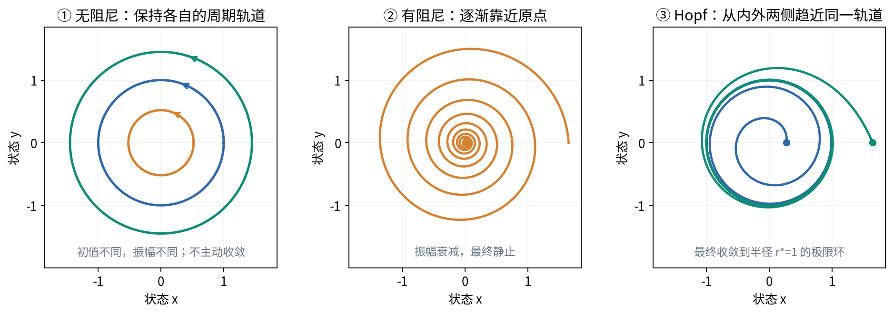
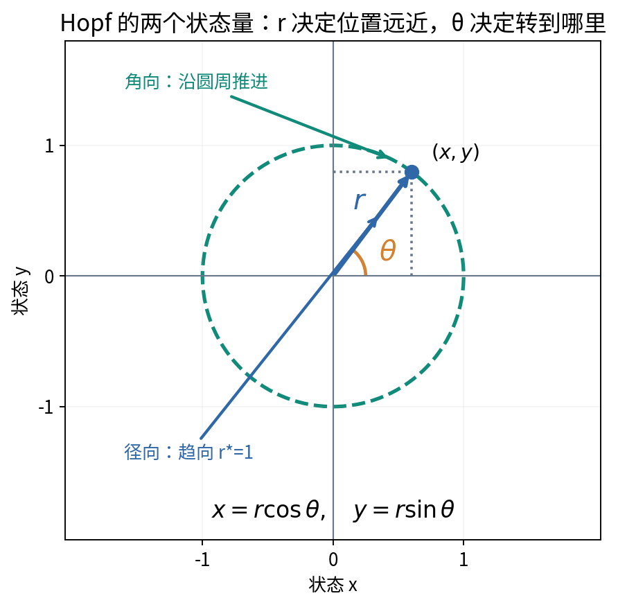
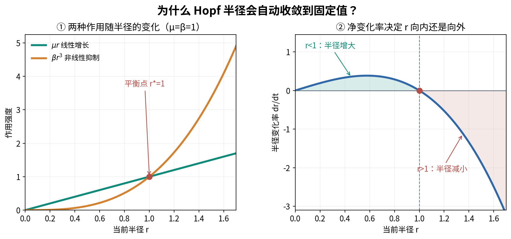
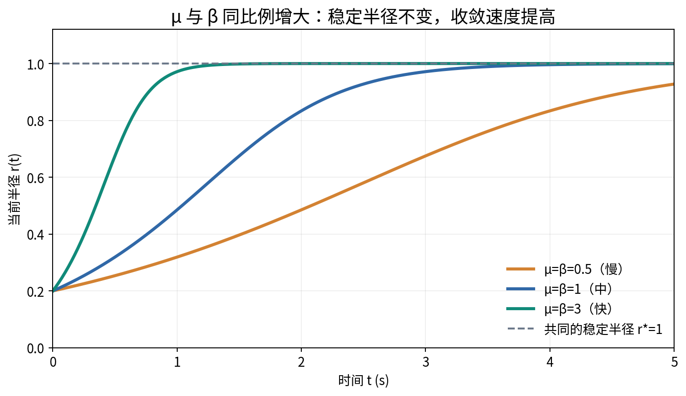
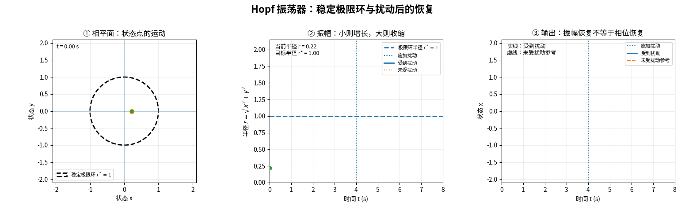

# 数学振荡器与 Hopf 振荡器

> **本篇核心**
>
> 数学振荡器通过动态方程产生周期性信号。理解振荡器，需要掌握振幅、频率和相位；理解自维持振荡，需要掌握极限环。Hopf 振荡器通过径向动力学调节振幅，通过角向动力学推进相位，形成稳定周期运动。

## 1. 什么是数学振荡器？

数学振荡器（Mathematical Oscillator）是能够产生周期性变化的动态系统。其状态随时间不断变化，并在一定条件下重复相似的运动过程。

一个简单例子是无阻尼弹簧振子。根据牛顿第二定律：

$$
m\ddot{x}=-kx
$$

整理得到：

$$
\boxed{\ddot{x}+\frac{k}{m}x=0}
$$

其解为：

$$
x(t)=A\cos(\omega t+\varphi)
$$

其中：

$$
\omega=\sqrt{\frac{k}{m}}
$$

这个方程描述了理想无阻尼振荡。

### 1.1 振荡器的三个基本参数

对于：

$$
x(t)=A\cos(\omega t+\varphi)
$$

三个核心参数分别是：

| 参数 | 含义 | 对应的运动特征 |
|---|---|---|
| $A$ | 振幅（Amplitude） | 运动幅度有多大 |
| $\omega$ | 角频率（Angular frequency） | 周期推进有多快 |
| $\varphi$ | 初始相位（Initial phase） | 从周期的哪个位置开始 |

角频率与普通频率的关系：

$$
\omega=2\pi f
$$

周期为：

$$
T=\frac{2\pi}{\omega}=\frac{1}{f}
$$

相位随时间变化时：

$$
\theta(t)=\omega t+\varphi
$$

相位表示振荡进行到周期中的哪个位置。一个完整周期对应 $2\pi$ rad，即 $360^\circ$。

### 1.2 对应到机器人运动

如果用周期信号生成关节参考角度，可以写成：

$$
q(t)=q_0+A\cos(\omega t+\varphi)
$$

其中 $q_0$ 是关节中心位置，$A$ 是关节运动幅度，$\omega$ 是运动节律的角频率，$\varphi$ 是初始相位。

这种方式可以生成周期性关节参考信号。但单纯的正弦轨迹不会自动根据触地、冲击或关节状态进行适应；这些能力需要进一步引入反馈和动态调节机制。

## 2. 无阻尼振荡与有阻尼振荡

### 2.1 无阻尼振荡器

无阻尼弹簧振子满足：

$$
\ddot{x}+\omega_0^2x=0
$$

其状态可以用位置和速度表示为 $(x,\dot{x})$。系统能量守恒，不同初始条件通常对应不同的闭合轨迹。初始振幅被保持，但系统不会主动回到某一条指定的轨迹。

需要区分两种扰动：

- 如果扰动改变了相位，系统会从新的相位继续运动；
- 如果扰动改变了状态向量的模长，系统会沿新的振幅轨迹继续运动。

因此，无阻尼振荡器能够持续振荡，但没有振幅误差的自动恢复机制。

### 2.2 有阻尼振荡器

有阻尼弹簧振子满足：

$$
\ddot{x}+c\dot{x}+\omega_0^2x=0
$$

在欠阻尼条件下，其解可写为：

$$
x(t)=A_0e^{-\frac{c}{2}t}\cos(\omega_dt+\varphi)
$$

其中：

$$
\omega_d=\sqrt{\omega_0^2-\frac{c^2}{4}}
$$

指数项 $e^{-\frac{c}{2}t}$ 使振幅逐渐衰减，最终状态趋向平衡点。

### 2.3 三种行为的区别

| 系统 | 长期行为 | 扰动后的振幅行为 |
|---|---|---|
| 无阻尼振荡器 | 保持初始振幅持续振荡 | 不主动恢复到原振幅 |
| 有阻尼振荡器 | 振幅衰减，趋向静止平衡点 | 通常继续衰减 |
| 稳定极限环振荡器 | 趋向稳定周期轨迹 | 在吸引域内恢复到极限环附近 |

*图 1：三种振荡系统在状态空间中的典型轨迹。左图强调“保持初值”，中图强调“衰减”，右图强调“向稳定极限环收敛”。*

## 3. 状态空间与极限环

### 3.1 为什么要从一维信号转向二维状态？

考虑两个状态变量：

$$
\begin{cases}
\dot{x}=f(x,y)\\
\dot{y}=g(x,y)
\end{cases}
$$

系统在任意时刻的状态为：

$$
P(t)=(x(t),y(t))
$$

随着时间变化，状态点在二维平面中移动，形成一条轨迹。这种图称为相平面图（Phase Portrait）。

### 3.2 什么是极限环？

极限环（Limit Cycle）是非线性动态系统中的一种孤立周期轨道。

稳定极限环具有吸引性：在其吸引域内，附近的轨迹会逐渐趋向这条周期轨道。

需要注意：

- 极限环不是“任何一个圆形轨迹”的统称；
- 它是一条由系统动力学决定的周期轨道；
- 稳定极限环只保证其吸引域内的轨迹趋近它；
- 它不意味着系统在任意强扰动下都能恢复；
- 恢复到极限环不等于恢复到扰动前的相位。

## 4. Hopf 振荡器

Hopf 振荡器是一种经典的非线性自维持振荡器。它通过线性增长项和非线性饱和项之间的竞争，使振幅趋向稳定值，同时通过相位动力学维持周期运动。

### 4.1 笛卡尔坐标形式

$$
\boxed{
\begin{cases}
\dot{x}=\mu x-\omega y-\beta(x^2+y^2)x\\
\dot{y}=\omega x+\mu y-\beta(x^2+y^2)y
\end{cases}
}
$$

通常考虑：

$$
\mu>0,\qquad \beta>0
$$

其中 $x,y$ 是振荡器的两个连续状态；$\mu$ 是线性增长系数；$\beta$ 是非线性饱和系数；$\omega$ 是角频率参数。

### 4.2 转换为极坐标形式

定义：

$$
r=\sqrt{x^2+y^2}
$$

$$
\theta=\operatorname{atan2}(y,x)
$$

其中 $r$ 是状态点到原点的距离，$\theta$ 是状态点相对于正 $x$ 轴的角度。

将原方程转换为极坐标，可得：

$$
\boxed{
\begin{cases}
\dot r=\mu r-\beta r^3\\
\dot\theta=\omega
\end{cases}
}
$$

这两个方程分别描述径向和角向动力学。

*图 2：$r$ 决定状态点距离原点有多远，$\theta$ 决定状态点在圆周上的位置。*

### 4.3 半径为什么会收敛？

径向方程可以写为：

$$
\dot r=r(\mu-\beta r^2)
$$

当 $r>0$ 时：

- 若 $r<\sqrt{\mu/\beta}$，则 $\dot r>0$，半径增大；
- 若 $r>\sqrt{\mu/\beta}$，则 $\dot r<0$，半径减小；
- 若 $r=\sqrt{\mu/\beta}$，则 $\dot r=0$，半径保持不变。

因此，非零稳定半径为：

$$
\boxed{r^*=\sqrt{\frac{\mu}{\beta}}}
$$

其形成原因是：

$$
\underbrace{\mu r}_{\text{线性增长作用}}
-
\underbrace{\beta r^3}_{\text{非线性抑制作用}}
$$

两种作用在稳定半径处恰好平衡。这里的“抑制”是方程构造的非线性饱和机制，不应直接等同于机器人中的机械摩擦或物理阻尼。

*图 3：当 $r<r^*$ 时，$\dot r>0$，半径增长；当 $r>r^*$ 时，$\dot r<0$，半径减小。*

### 4.4 $\mu$ 和 $\beta$ 分别控制什么？

稳定半径由二者的比值决定：

$$
r^*=\sqrt{\frac{\mu}{\beta}}
$$

- 增大 $\mu$，保持 $\beta$ 不变：稳定半径增大；
- 增大 $\beta$，保持 $\mu$ 不变：稳定半径减小。

如果同时同比例放大：

$$
\mu'=k\mu,\qquad\beta'=k\beta
$$

则：

$$
r'^*=\sqrt{\frac{k\mu}{k\beta}}=r^*
$$

稳定半径不变，但径向动态整体加快。

在稳定半径附近，令：

$$
r=r^*+\varepsilon
$$

线性化可得：

$$
\dot{\varepsilon}\approx-2\mu\varepsilon
$$

所以局部误差近似按下式衰减：

$$
\varepsilon(t)=\varepsilon(0)e^{-2\mu t}
$$

同比放大两个参数 $k$ 倍后，局部收敛速率也放大 $k$ 倍。

*图 4：$\mu=\beta$ 始终保证 $r^*=1$；同比增大两个系数可以缩短半径收敛所需时间。*

### 4.5 相位为什么还需要一个独立方程？

二维状态点的位置由半径和角度共同决定：

$$
(x,y)\longleftrightarrow(r,\theta)
$$

因此，仅描述半径变化还不够，还必须描述状态点如何旋转：

$$
\boxed{\dot\theta=\omega}
$$

积分得到：

$$
\theta(t)=\theta_0+\omega t
$$

稳定振荡时：

$$
\boxed{
\begin{cases}
x(t)=r^*\cos(\omega t+\theta_0)\\
y(t)=r^*\sin(\omega t+\theta_0)
\end{cases}
}
$$

完整的 Hopf 振荡器因此可以写成：

$$
\boxed{
\begin{cases}
\dot r=\mu r-\beta r^3\\
\dot\theta=\omega
\end{cases}
}
$$

或者使用前面的笛卡尔坐标方程。

当 $r=0$ 时，相位没有定义；笛卡尔坐标方程仍然可以正常使用。对于该理想模型，原点也是平衡点，恰好从原点出发不会自行产生振荡。

### 4.6 Hopf 振荡器的扰动恢复能力

稳定极限环的吸引性意味着，在合适参数和吸引域内：

- 振幅偏小，径向动力学推动状态向外；
- 振幅偏大，径向动力学推动状态向内；
- 最终回到稳定半径附近。

但标准 Hopf 振荡器的相位方程是：

$$
\dot\theta=\omega
$$

它没有自动恢复到扰动前相位的机制。因此，扰动后可以恢复振幅，却保留相位偏移。

> **动态演示：第 4 秒对 Hopf 状态施加瞬时扰动**
>
> 下方 GIF 同步显示**相平面轨迹、半径变化、周期输出**。注意：扰动后半径逐渐恢复至 $r^*=1$，但右侧输出不一定与未扰动的参考曲线恢复同相。

*图 5：Hopf 振荡器的极限环吸引性与相位偏移。若动画未播放，可查看 [静态预览图](/assets/images/oscillators/hopf/perturbation-preview.png)。*

## 5. Hopf 振荡器与机器人运动控制

假设一个 Hopf 振荡器输出两个信号：

$$
x(t)=r(t)\cos\theta(t)
$$

$$
y(t)=r(t)\sin\theta(t)
$$

可以将其映射到机器人关节参考角：

$$
q_h(t)=q_{h,0}+k_hx(t)
$$

$$
q_k(t)=q_{k,0}+k_ky(t)
$$

其中 $k_h,k_k$ 是映射系数。

这样可以通过 $\mu,\beta$ 调节稳定振幅，通过 $\omega$ 调节振荡频率，通过初始状态调节初始相位。

这只是一个简化的关节信号生成示例。实际步态还需要考虑关节运动范围、髋膝协调、支撑与摆动时间、足端轨迹和地面接触。

## 6. 从数学振荡器到 CPG 的知识路线

| 阶段 | 核心知识 | 需要回答的问题 |
|---|---|---|
| 1. 数学振荡器 | 振幅、频率、相位 | 如何产生周期信号？ |
| 2. 极限环与 Hopf | 非线性动力学、稳定性 | 如何形成稳定自维持振荡？ |
| 3. 神经元模型 | 神经元状态、兴奋、抑制、脉冲 | 如何描述神经元活动？ |
| 4. 神经振荡器 | 神经元动力学与网络作用 | 如何产生神经节律？ |
| 5. 振荡器耦合 | 相位同步、耦合强度、相位偏置 | 多个振荡器如何协调？ |
| 6. CPG | 网络拓扑、感觉反馈、运动映射 | 如何产生多肢协调步态？ |
| 7. CPG-RL | 策略调节振荡器参数 | 如何学习自适应运动？ |

## 7. 本篇最重要的结论

> 数学振荡器通过动态方程产生周期性信号。Hopf 振荡器利用线性增长和非线性饱和之间的平衡形成稳定极限环，并通过独立的相位动力学维持周期运动。它为后续理解神经振荡器、振荡器耦合和 CPG 提供了重要的数学基础。

## 延伸阅读

- [Hopf bifurcation - Google Scholar](https://scholar.google.com/scholar?q=Hopf+bifurcation+nonlinear+dynamics)
- [Hopf oscillator - Google Scholar](https://scholar.google.com/scholar?q=Hopf+oscillator+robot+locomotion)
- [Central Pattern Generators for Locomotion Control in Animals and Robots](https://doi.org/10.1016/j.neunet.2008.03.014)

下一篇：[神经元模型与 Stein 神经振荡器：从单神经元到耦合相位同步](/posts/stein-neural-oscillator/)
