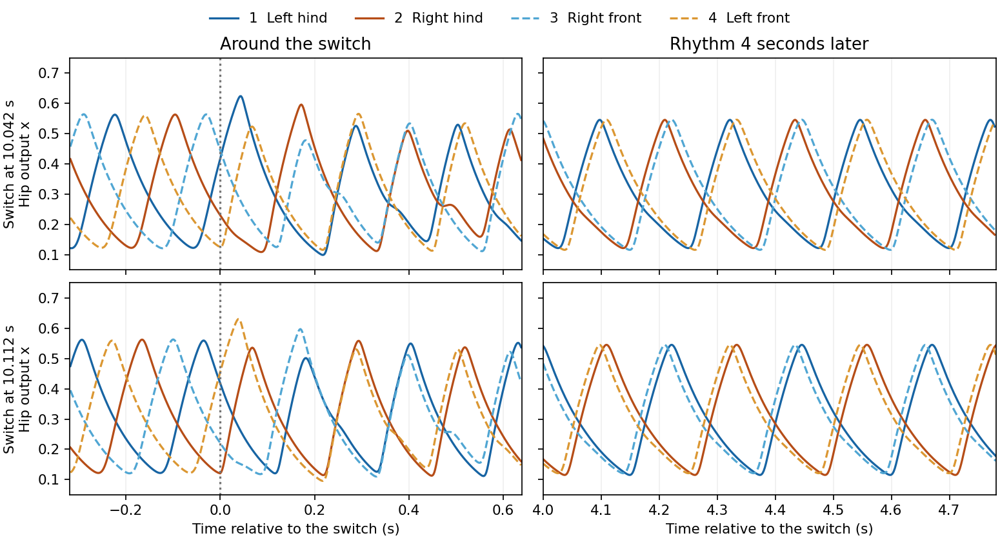
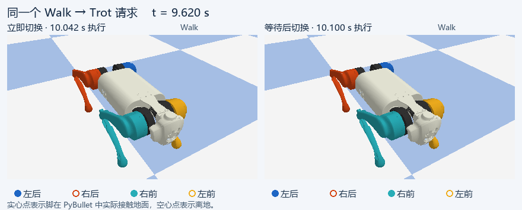
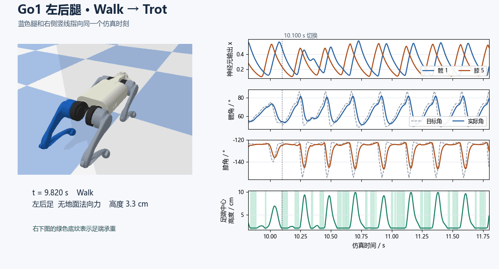

# 八神经元 Stein CPG 的 Python 复现，从单神经元到 Go1 步态切换

**学习日期 2026 年 11 月 16 日**

四条腿的相位关系怎样从耦合方程里形成，收到换步态指令后又怎样变成 Go1 的抬脚和触地？从单个 Stein 神经元开始，先跑出八节点 Walk 和 Trot，再比较直接切换与等待后切换，最后把一条腿的神经元信号、关节角和实际触地放在同一时间轴。复现对象是 Liu 等人的 *An eight-neuron network for quadruped locomotion with hip-knee joint control*。 [IJRR 正式版](https://doi.org/10.1177/02783649251364286) · [作者公开代码](https://github.com/ImDipsy/cpg_go1_simulation)

## 1. 从双神经元的相位差追到四腿网络

今天最先卡住的问题是，四个节点用三条连接就能连起来，为什么还要讨论四边形闭环？

如果只考虑**给定目标相位差**，四个节点选定一个参考后，有三个独立的相位差。连通的三条边就可以沿路径表达这三个差值。增加第四条边形成环以后，还要检查沿环的相位差之和是否为 $0\pmod{2\pi}$。实际能否在扰动后回到目标关系，需要另外检查各节点能否锁定同一频率，以及相对相位受扰后是否收敛。这个区分解释了为什么同一个相位目标会有多种连线方案，以及为什么论文会根据步态的对称性设计连线。 [论文的网络对称性与步态表](https://arxiv.org/html/2406.13419v1#S2.SS2)

双节点练习里，设 $\Delta=\theta_2-\theta_1$，便有 $\dot\Delta=\dot\theta_2-\dot\theta_1$。两个节点暂时以不同速度推进，就会改变相对时序。把这个想法扩到四条腿，按左前、右前、左后、右后的顺序，Trot 的目标是 $[0,\pi,\pi,0]$，Pace 的目标是 $[0,\pi,0,\pi]$。取切换进度 $s$ 从 0 增至 1，一条使前后各自保持左右反相的教学用目标路径是

$$
\Phi^*(s)=[0,\ \pi,\ (1-s)\pi,\ -s\pi]\pmod{2\pi}.
$$

这条路径帮助理解**显式调节目标相位差**。它承接前面的相位约化练习。相位约化、相位响应曲线（PRC）以及耦合函数可用于分析简化的振荡器模型。这里复现八节点结果时，直接积分完整的 Stein 方程。后面复现 IJRR 时，八节点 Stein 程序使用另一项具体操作。切换时改驱动和响应参数，再继续积分，实际相位关系从输出波形中测得。 [此前的显式相位过渡练习](https://xiaoyong-daydayup.github.io/posts/cpg-gait-transition/) · [论文的切换策略](https://arxiv.org/html/2406.13419v1#S4.SS2)

论文的工作可以顺着依赖关系来读。先看对称性和 $H/K$ 怎样描述步态，再看如何把四个腿部节律扩成八个髋膝节点。接下来是 Stein 方程、五类稳态节律、20 种有向转换、关节角映射、Go1 物理仿真以及传感反馈。其中最需要做对照实验的是切换。即使目标参数相同，执行那一刻的网络状态也可能把系统带到另一种节律。 [此前的论文精读](https://xiaoyong-daydayup.github.io/posts/eight-neuron-cpg-reading/) · [IJRR 正式版](https://doi.org/10.1177/02783649251364286)

## 2. 在 Python 里验证一个 Stein 神经元

单节点状态是 $x,y,z$。函数 `stein_rhs()` 接收当前状态、响应系数 $a$ 和驱动 $f_c$，返回三个变化率。`rk4_step()` 用变化率把状态推进一个时间步。

$$
u=f_c+b(y-z),\qquad
\dot{x}=a[\sigma(u)-x],\qquad
\dot{y}=x-py,\qquad
\dot{z}=x-qz,
\qquad
\sigma(u)=\frac{1}{1+e^{-u}}.
$$

取 $a=10$、$b=-2000$、$p=10$、$q=30$，从 $(x,y,z)=(0.2,0,0)$ 出发。当 $f_c=40$ 时，初始导数约为 $(8,0.2,0.2)$。$y,z$ 以不同的速率变化，它们的差又反馈到 $x$，因此恒定驱动下也能产生重复振荡。用四阶 Runge–Kutta 法以 2 ms 步长积分，去掉前 2 s 后，用相邻峰值的时间差估计周期。

| 单节点驱动 | 实测平均周期 | 实测频率 |
| --- | ---: | ---: |
| $f_c=40$ | 0.2480 s | 4.032 Hz |
| $f_c=45$ | 0.2452 s | 4.078 Hz |

这一步确定了以后读代码的顺序。先找脚本入口 `main()` 和参数，再看每个函数接收什么、返回什么，最后用一组手算结果核对输出。改参数时只改一项，跑两遍比较。 [Stein 振荡器的前置笔记](https://xiaoyong-daydayup.github.io/posts/stein-neural-oscillator/) · [相位响应与耦合的前置笔记](https://xiaoyong-daydayup.github.io/posts/stein-prc-and-coupling/)

## 3. 八个节点怎样同时决定腿间时序和髋膝时序

论文编号与上面的四相位练习顺序不同。这里每个神经元保存三个状态，八个节点合起来是 24 个状态。

| 腿 | 左后 | 右后 | 右前 | 左前 |
| --- | ---: | ---: | ---: | ---: |
| 髋屈伸节点 | 1 | 2 | 3 | 4 |
| 膝屈伸节点 | 5 | 6 | 7 | 8 |

髋层和膝层各有一个方向相反的单向环，层内耦合权重都是 $-0.15$。同一条腿还用两条边连起髋和膝，髋到膝为 $\gamma=-0.60$，膝到髋为 $\delta=-0.10$。两条边都是抑制性耦合，髋到膝的作用较强。腿间的节拍和同腿髋膝的节拍由整个网络共同决定。 [论文的八节点结构](https://arxiv.org/html/2406.13419v1#S3.SS1) · [论文的耦合参数](https://arxiv.org/html/2406.13419v1#S3.SS3)

用左后腿的膝节点 5 走一遍数据。Trot 的膝层基础驱动参数是 $41$，膝 5 同时读取同层的膝 7 和同腿的髋 1，因此

$$
f_{c,5}=41(1-0.15x_7-0.60x_1).
$$

论文初值里 $x_7=x_1=1$，所以第一帧 $f_{c,5}=10.25$。髋节点 1 的第一帧输入是 $30.75$。往后运行时，$x_7,x_1$ 在变，每个积分子步都用**当时同一份网络状态**重算八路驱动。Python 从 0 开始索引，所以论文的节点 7 对应 `x[6]`。比如 `knee_neighbor_x = x[[6, 7, 5, 4]]` 读的是膝 5、6、7、8 各自的同层输入，第三项对应**膝 6 → 膝 7**。再沿髋 3 到膝 7 的连接代入 $x_6=x_3=0.8$，得到 $f_{c,7}(0)=41(1-0.15\times0.8-0.60\times0.8)=16.4$。

随后用参数表选 Walk 或 Trot，两组步态共用八节点方程。

| 步态 | 髋层 $(a,f,k_1,k_2)$ | 膝层 $(a,f,k_1,k_2)$ | 数值仿真结果 |
| --- | --- | --- | --- |
| Walk | $(10,40,0,0)$ | $(10,40,0,0)$ | 周期约 0.259 s，髋峰按 $1\rightarrow4\rightarrow2\rightarrow3$ 出现，相邻约 65 ms |
| Trot | $(11,41,0.085,56)$ | $(11,41,0,0)$ | 峰值插值测得周期约 0.2244 s，髋 1 与 3、髋 2 与 4 分别接近同相 |

这里 $a$ 控制 Stein 方程的响应，$f$ 是基础驱动，$k_1,k_2$ 分别调节正弦项的幅度和角频率。正式版表 7 给出 Walk 和 Trot 的参考周期分别为 0.259 s、0.224 s。教学代码用 2 ms 积分，作者代码内部用 0.1 ms。将教学版步长减半，Trot 的周期和稳态波形基本一致。复现从作者公布的参数起步。若要为另一台机器人重新找参数，需要记录搜索范围、步长、初值、成功判据和失败样例。 [论文的稳态步态实验](https://arxiv.org/html/2406.13419v1#S4.SS1) · [作者的参数与积分设置](https://github.com/ImDipsy/cpg_go1_simulation/blob/main/src/cpg_go1_simulation/stein/base.py#L21)

为了验证髋膝连接的作用，我对比了原来的 $\gamma=-0.60$ 和 $\gamma=0$。原版里左后腿的膝峰比髋峰早约 63 ms，每一周期都保持这个间隔。去掉髋到膝的作用之后，两者仍各自振荡，髋和膝的周期分别约为 0.2242 s、0.2361 s，峰值间隔逐周期漂移。这样就能把「产生振荡」和「形成锁相」分别观察。论文也通过扫描 $\gamma$，测量同腿髋膝偏移怎样变化。 [论文的髋膝相位调节实验](https://arxiv.org/html/2406.13419v1#S6.SS3)

## 4. Walk → Trot 要在什么状态下切

切换时，程序先用 Walk 参数积分到执行时刻，取 `walk_states[-1]`，把八个节点的全部 $x,y,z$ 交给 Trot 方程继续积分。切换点的状态连续，目标驱动的局部时钟从零起算。实际是同侧腿配对还是对角腿配对，要看积分结果。 [作者代码中的切换计时](https://github.com/ImDipsy/cpg_go1_simulation/blob/main/src/cpg_go1_simulation/stein/implementations.py#L453-L481)

| 试验 | 收到请求 | 实际执行 | 执行时的髋 1 | 后续节律 |
| --- | ---: | ---: | --- | --- |
| 直接切换 A | 10.042 s | 10.042 s | $x_1=0.417$，正在上升 | 髋 1 和 4、2 和 3 接近同相，呈 Pace 型 |
| 直接切换 B | 10.112 s | 10.112 s | $x_1=0.418$，正在下降 | 髋 1 和 3、2 和 4 接近同相，进入 Trot |
| 等待后切换 | 10.042 s | 10.100 s | $x_1=0.471$，正在下降 | 进入 Trot，等待 58 ms |

作者通过扫描 Walk 周期中的多个执行时刻，观察最终会进入哪种节律，寻找连续成功的区域。对 **Walk → Trot**，公开代码用髋 1 的下降段识别这段窗口，条件是 $0.30<x_1<0.48$ 且 $x_1$ 比上一帧低。收到请求后继续按 Walk 跑，一旦满足条件就换参数。这一对照里，两次直接切换的 $x_1$ 几乎同高，但分别处于上升和下降阶段，网络的完整状态已经不同。 [论文的直接切换与等待策略](https://arxiv.org/html/2406.13419v1#S4.SS2) · [作者代码中的等待判据](https://github.com/ImDipsy/cpg_go1_simulation/blob/main/src/cpg_go1_simulation/stein/implementations.py#L349-L357)

在 Go1 的 PyBullet 仿真里，两组都继续走了下来。直接切换组的左后足更常与左前足一起触地，等待组的左后足更常与右前足一起触地。动画下方的实心圆取自 PyBullet 的脚地接触记录。这里的切换失败指**落入了另一种脚步配对**。使用了作者公开的 URDF 和预训练关节映射，Windows 上运行的是 PyBullet 3.2.5，论文仿真使用 3.2.6。 [作者的 Go1 演示与关节控制](https://github.com/ImDipsy/cpg_go1_simulation/blob/main/examples/demo_video4_gait_transition.py#L214)

## 5. 一条左后腿怎样从神经元信号走到落脚

在同一个 PyBullet 时钟里追踪左后腿，控制链就能一段段核对。髋 1 和膝 5 各自产生 $x,\dot{x}$，预训练的 MLP 根据这些量、关节编号、步态命令和步幅给出髋屈伸与膝屈伸的目标角。电机将这些角度作为位置目标，PyBullet 再计算实际角度、足端位置和地面接触力。每个物理步先读当前实际状态，再施加当前目标推进下一步，因此曲线、实测量和镜头用的是同一个采样时刻。 [作者的执行网络输入与输出](https://github.com/ImDipsy/cpg_go1_simulation/blob/main/src/cpg_go1_simulation/gait_and_transition/process_network.py#L67)

看等待组切到 Trot 后的一次摆动：

- **11.540 s** 左后足承重，足端中心约高 2.0 cm。
- **11.566 s** 膝节点 5 的信号达到峰值。
- **11.608 s** 足端中心达到约 9.7 cm 的最高点。此时髋目标角约 57°，实际角约 72°。
- **11.628 s** 髋节点 1 的信号才到峰。
- **11.684 s** 左后足重新测到地面法向力。

角度图中用虚线画目标、实线画实际值，底图以绿色标出足端有支撑力的时段。量的是足端碰撞球中心，因此承重时约高 2 cm。真正要对齐的是**信号峰值、关节跟踪、触地事件**三类时刻。单看其中一条曲线，很难判断这一脚在地面上实际怎样运动。

### 复现脚本和阅读入口

| 脚本 | 先读哪里 | 做了什么 |
| --- | --- | --- |
| `stein_single.py` | `stein_rhs()` 和 `main()` | 单节点积分、测周期、手算膝 5 输入 |
| `stein_trot.py` | `GAIT_PARAMETERS` 和 `gait_drive()` | 共用八节点方程，选 Walk 或 Trot |
| `stein_walk_to_trot.py` | `simulate_walk_to_trot()` 和 `find_wait_switch_index()` | 保留切换点状态，比较执行时机 |
| `stein_go1_pybullet.py` | `build_trial()` 和 `joint_targets()` | 把两种切换策略接到 Go1 |
| `stein_go1_left_leg.py` | `record_left_leg()` 和 `show_frame()` | 记录实际角度、足端高度和法向力，并用滑条同步回看 |

## 6. IJRR 的监督映射与后来加入 PPO 的工作

今天也追问了执行网络（ENN）的训练。IJRR 中，监督标签来自预设足端轨迹的逆运动学角度。一个样本对应一个关节在一个时刻的状态。3 个关节标识分量、5 个步态编码分量、1 个步幅参数和 $x_i,\dot x_i/50$ 拼成 11 维输入，经 $11\rightarrow24\rightarrow12\rightarrow1$ 的 MLP 预测该关节的目标角。公开训练代码用角度均方误差和 Adam，初始学习率为 0.01，批大小为 32，最多训练 100 轮，使用八成样本训练并保留验证损失最低的权重。本次 Go1 对照直接加载作者的预训练权重。 [作者的执行网络训练代码](https://github.com/ImDipsy/cpg_go1_simulation/blob/cef012f12fed7316e307034d48f9c13df909de15/src/cpg_go1_simulation/execution_neural_network/mlp.py)

延伸阅读的 *A Trainable CPG Framework for Quadruped Locomotion* 是后来在 Go2 上验证的工作。它先离线监督训练 ENN，再冻结 ENN，让 PPO 反馈策略根据速度指令和本体感知调节 6 个足端轨迹参数。这 6 项包括机身参考高度、摆动抬脚高度、支撑轨迹的下探量、公共步长、转向偏置和水平轨迹朝向。八节点 CPG 继续提供步态节律。切换时，后续工作从共同时钟下选取目标步态的当前状态。监督映射、节律发生器和反馈策略的分工值得在双足任务中分别检验。 [Go2 后续论文的方法](https://arxiv.org/html/2610.36537v1#S3)

## 7. 怎样把这次复现接到双足

已跑通的链路是 **单节点 → 八节点 Walk/Trot → 等待切换 → Go1 动作 → 左后足触地**。继续复现这篇论文，可以把同样的峰值和触地测量扩到四条腿，记录请求时刻、执行时刻和实际配对形成的时刻，再做更多转换与传感反馈实验。

面向双足，先用左右两个节律信号组织支撑与摆动，把它们映射到双足自己的足端轨迹和关节参考。站立、重心转移、原地踏步、慢走依次跑通后，再在相同平衡控制器下比较固定相位时钟、Stein CPG 和带触地反馈的 CPG。用触地顺序、连续稳定步数、躯干姿态和扰动恢复来判断改动是否有益。Go1 上这次学到的读数顺序可以直接复用：从**相位 → 目标角 → 实际角 → 触地**追完整条链。 [双足 CPG 与反馈的研究实例](https://doi.org/10.1177/0278364917743320)
