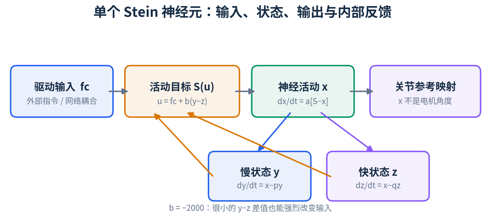
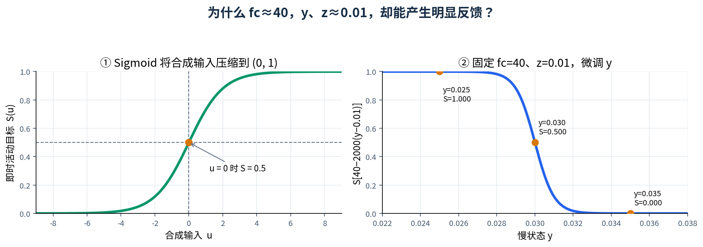
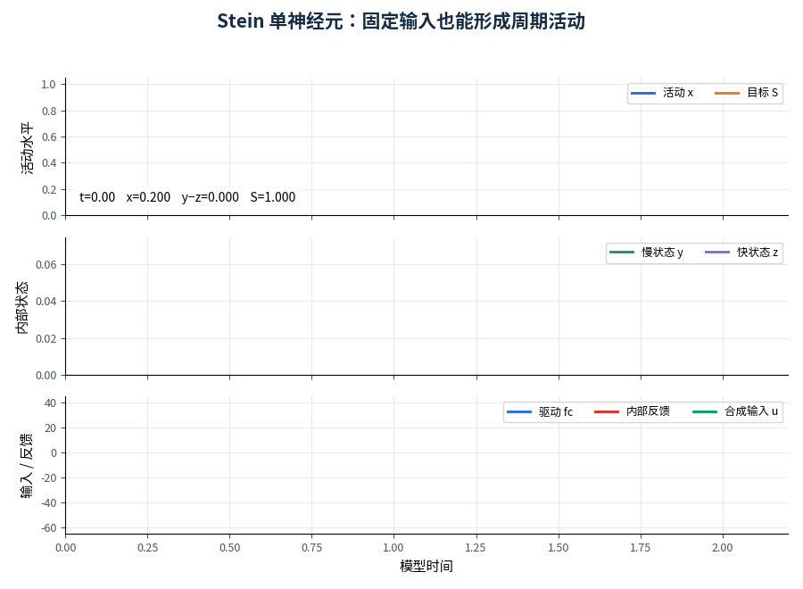
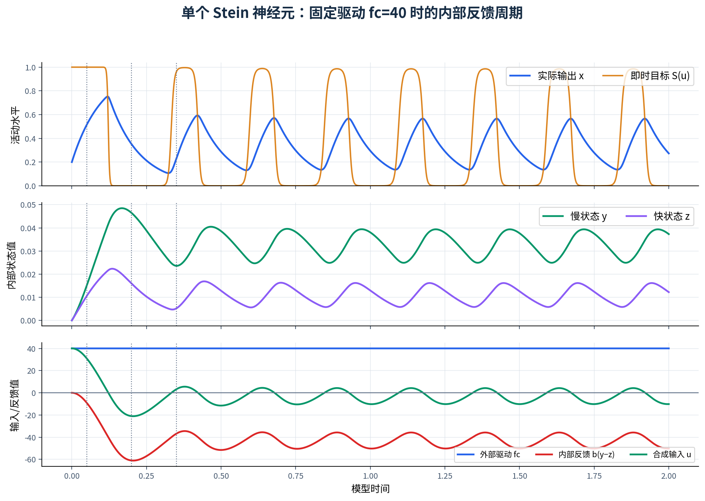
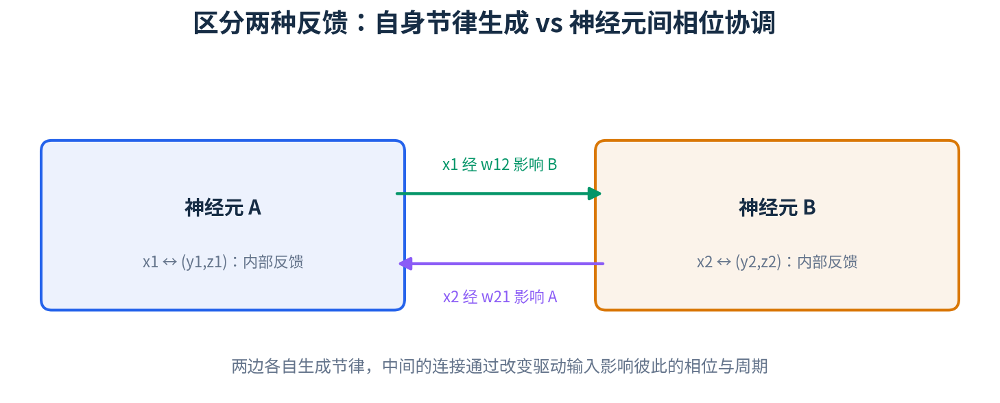
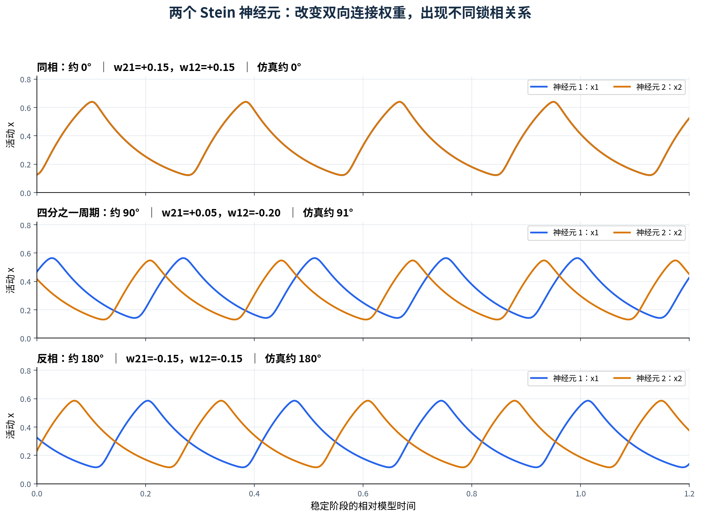
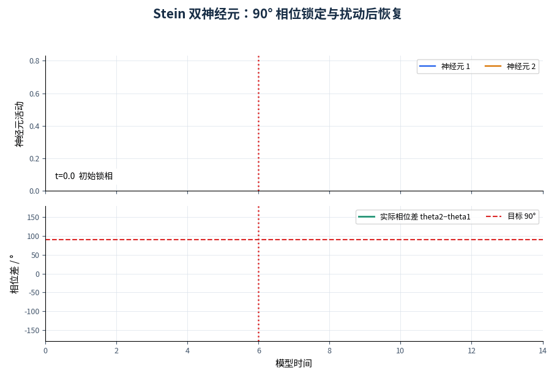
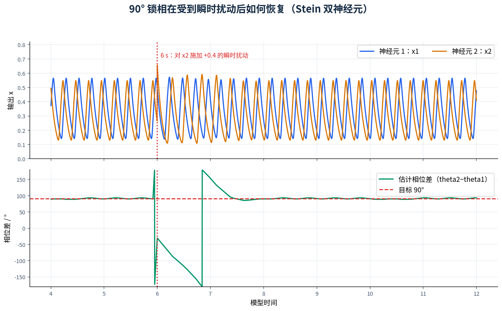

# 神经元模型与 Stein 神经振荡器：从单神经元到耦合相位同步

> **本篇要回答什么？**
>
> 1. 神经元模型与数学振荡器有什么区别？
> 2. 单个 Stein 神经元的输入、输出与内部状态是什么？数值量级为什么差别很大？
> 3. 为什么恒定的外部驱动也能使单个神经元持续振荡？
> 4. 两个 Stein 神经元如何通过连接权重形成同相、反相或其他相位差？
> 5. 已知目标相位差，怎样具体设计并验证耦合权重？
>
> 本笔记承接 [数学振荡器与 Hopf 振荡器](/posts/hopf-oscillator/)。附图与 GIF 均为依照方程重新计算制作的**教学仿真**，不是从论文复制的原始图件。所用简化双神经元网络也不等于论文完整的八神经元 CPG。

## 1. 从数学振荡器到神经元模型

在上一课中，Hopf 振荡器用两条方程直接描述振幅收敛和相位推进：

$$
\dot r=\mu r-\beta r^3,\qquad \dot\theta=\omega.
$$

神经元模型则首先描述**一个神经元如何根据输入、内部状态及历史活动改变输出**。一个神经元未必一定振荡：它也可能趋向静息、持续发放脉冲，或者输出连续活动水平。

- **LIF（漏积分发放）模型**：膜电位积累、泄漏、达到阈值时发放脉冲并重置；适合理解神经元输入与发放事件。
- **Matsuoka 神经振荡器**：常用两个具有适应性和相互抑制的活动单元形成交替节律；用于理解屈曲/伸展活动为什么能轮流占优势。相互抑制本身不保证一定振荡。
- **Stein 神经元**：通过自身三个状态及其非线性反馈，在合适参数下可形成周期活动；多个 Stein 神经元相互连接后，可以进一步产生协调的节律关系。

> **三个不同层次**
>
> **神经元模型**描述单元怎样变化；**神经振荡器**描述节律怎样产生；**CPG 网络**描述多个节律怎样组织成协调的运动模式。CPG 也可直接使用 Hopf 等数学振荡器，不必一定采用生物神经元模型。

## 2. 单个 Stein 神经元的完整模型

以下采用我们前面讨论的 Stein 三状态形式：

$$
\boxed{\begin{aligned}
\dot x&=a\left[S\big(f_c+b(y-z)\big)-x\right],\\
\dot y&=x-py,\\
\dot z&=x-qz.
\end{aligned}}
$$

其中 Sigmoid 函数为：

$$
S(u)=\frac{1}{1+e^{-u}},\qquad u=f_c+b(y-z).
$$

### 2.1 输入、输出和内部状态

| 符号 | 在模型中的职责 | 怎样理解 |
|---|---|---|
| $f_c$ | 作用于该神经元的总驱动 | 在单神经元实验中设为常数；在 CPG 网络中可包括高层刺激和其他神经元通过连接传来的影响 |
| $x$ | 主要活动输出 | 实际神经活动水平；可用于后续关节参考信号映射 |
| $y$ | 较慢的内部状态 | 追踪过去的 $x$，响应时间尺度约为 $1/p$ |
| $z$ | 较快的内部状态 | 同样追踪 $x$，但响应时间尺度约为 $1/q$ |
| $S(u)$ | 即时活动目标 | 将合成输入 $u$ 映射到 $(0,1)$ |
| $a$ | 活动追踪速率系数 | 决定 $x$ 跟随即时目标的快慢，目标改变时会一起影响动态过程 |
| $b$ | 内部差值反馈权重 | 决定 $y-z$ 对输入 $u$ 的影响强度及方向 |

**注意：** 这里的 $f_c$ 不是电机电流，$x$ 也不是电机角度，更不能直接当作以毫伏为单位的真实生物膜电位。它们是人工神经动力学模型中的信号。机器人中还要经过运动映射、关节控制与实际动力学。

### 2.2 第一个方程最直观的理解

$$
\boxed{\dot x=a\big[S(u)-x\big]}
$$

- $S(u)>x$：$x$ 增大；
- $S(u)<x$：$x$ 减小；
- $S(u)=x$：该瞬间 $\dot x=0$。

因此，先由 $f_c$ 和 $y-z$ 算出一个**不断变化的即时目标**，再让 $x$ 逐渐向目标靠近。

在**目标 $S$ 恒定**的特殊情况下，$x$ 的响应时间常数是 $1/a$；但实际 Stein 神经元的 $S$ 会受到历史反馈持续改变，因此 $\dot x$ 不是固定速度。

## 3. 为什么 $f_c$ 可以是几十，而 $x,y,z$ 只有很小的数？

教学演示选用：

$$
a=10,\quad b=-2000,\quad p=10,\quad q=30,\quad f_c=40.
$$

在初值合理的情况下，$x$ 会被 $(0,1)$ 范围的即时目标所约束，因而长期活动大致在 0–1 之间。若初值 $x(0)\in[0,1]$，则 $x(t)$ 保持在 $[0,1]$ 内。

对于 $y,z$，如果暂时把 $x$ 看成常数：

$$
\dot y=0\Rightarrow y=\frac{x}{p},\qquad
\dot z=0\Rightarrow z=\frac{x}{q}.
$$

取 $x=0.6$，得到：

$$
y\to 0.060,\qquad z\to 0.020.
$$

所以 $y,z$ 比 $x$ 小，是模型结构造成的；但振荡时两者会相对 $x$ **产生时间滞后**，不能直接令 $y=x/p$、$z=x/q$ 当作每一时刻的精确关系。

真正送进 Sigmoid 的并不是分别独立的 $f_c,y,z$，而是：

$$
\boxed{u=f_c-2000(y-z)}.
$$

例如 $f_c=40$、$z=0.01$：

| $y$ | $y-z$ | 合成输入 $u$ | 即时目标 $S(u)$ |
|---:|---:|---:|---:|
| 0.025 | 0.015 | $+10$ | 约 1.000 |
| 0.030 | 0.020 | $0$ | 0.500 |
| 0.035 | 0.025 | $-10$ | 约 0.000 |

$y$ 只变化 0.005，就能显著改变即时目标，因为乘上了很大的负反馈权重 $b$。

**因此不要直接比较 $40$ 和 $0.03$ 的大小，而应该比较进入激活函数时的 $f_c$ 与 $b(y-z)$。**

## 4. 单个 Stein 神经元怎样自己形成周期振荡？

现在只考虑一个神经元，固定 $f_c=40$，没有其他神经元参与。其内部循环为：

$$
\boxed{x\uparrow\ \to\ (y,z)\text{发生滞后变化}\ \to\ S(u)\downarrow\ \to\ x\downarrow\ \to\ \text{抑制解除}\ \to\ S(u)\uparrow}.
$$

这不是要求所有变量在同一个时刻一起升降。关键是 $y,z$ 的响应速度不同，导致 $y-z$ 随活动历史变化；这个差值通过负反馈改变即时目标。

### 4.1 对照时间曲线观察

*动画 1：使用四阶 Runge–Kutta 数值积分，固定 $f_c=40$，连续显示 $x,S(u),y,z$ 以及输入反馈；播放的是模型输出，不是人为画的正弦波。*

对照几个具体时刻：

| 模型时间 | $x$ | $y$ | $z$ | $u=40-2000(y-z)$ | 观察结果 |
|---:|---:|---:|---:|---:|---|
| 0.05 | 0.515 | 0.0151 | 0.0106 | 约 +30.95 | 目标接近 1，$x$ 正增长 |
| 0.20 | 0.351 | 0.0465 | 0.0160 | 约 −21.01 | 目标接近 0，$x$ 正下降 |
| 0.35 | 0.228 | 0.0236 | 0.0052 | 约 +3.16 | 抑制减弱，目标升高，$x$ 开始恢复 |

**同样是固定 $f_c=40$，$x$ 却会反复上升和下降。** 这是因为神经元内部的历史反馈持续改变即时目标。

### 4.2 为什么它不一定最终停在某个平衡点？

平衡点满足：

$$
\dot x=\dot y=\dot z=0.
$$

代入第二、第三个方程：

$$
y^*=\frac{x^*}{p},\qquad z^*=\frac{x^*}{q}.
$$

再代入第一个方程，就得到：

$$
x^*=S\left(f_c+b\left(\frac{x^*}{p}-\frac{x^*}{q}\right)\right).
$$

对于上述教学参数，可数值求得：

$$
(x^*,y^*,z^*)\approx(0.3061,0.0306,0.0102).
$$

这组参数下，局部稳定性分析表明该平衡点**不稳定**。仿真进一步显示，系统趋向持续的周期振荡。**但是“平衡点不稳定＋活动有界”本身不构成三维系统必然存在稳定极限环的证明。**

> **选读：怎样检查平衡点是否稳定？**
>
> 在平衡点处令 $s=S'(u^*)=x^*(1-x^*)$，Jacobian 为：
>
> $$
> J=\begin{bmatrix}
> -a & a\,b\,s & -a\,b\,s\\
> 1 & -p & 0\\
> 1 & 0 & -q
> \end{bmatrix}.
> $$
>
> 代入 $a=10,b=-2000,p=10,q=30$ 及上述平衡点，得到一对实部为正的共轭特征值，约为 $5.87\pm37.29\mathrm{i}$，另一个特征值约为 $-61.74$。因此该平衡点局部不稳定；稳定周期轨道的存在和吸引性还需数值与进一步动力学分析。

## 5. 两个神经元怎样连接？

每个神经元依然保留自己的三个内部状态：

$$
(x_1,y_1,z_1),\qquad(x_2,y_2,z_2).
$$

现在只修改**各自总驱动的计算规则**。为理解耦合，采用下列简化的双向连接形式：

$$
\boxed{\begin{aligned}
f_{c1}&=40(1+w_{21}x_2),\\
f_{c2}&=40(1+w_{12}x_1).
\end{aligned}}
$$

- $w_{21}$：**神经元 2 → 神经元 1** 的影响权重；
- $w_{12}$：**神经元 1 → 神经元 2** 的影响权重。

这套系统里有**两种不同的反馈**：

1. **自身内部反馈：**$x_i\to(y_i,z_i)\to S_i\to x_i$，决定单个神经元的动态节律。
2. **神经元之间的耦合：**$x_1\to f_{c2}$ 与 $x_2\to f_{c1}$，改变对方的即时目标，从而影响活动时序与相位关系。

例如 $w_{12}=-0.15$ 时：

$$
f_{c2}=40(1-0.15x_1)=40-6x_1.
$$

若 $x_1$ 从 0.2 上升到 0.8，则神经元 2 的驱动从 38.8 降到 35.2。由于 Sigmoid 和内部状态反馈，**这种驱动改变未必只会降低幅值，还可能让下一次峰值提前或推迟**。

> **不能直接把权重当成相位角**
>
> $w=-0.15$ 并不等于 $180^\circ$；$w=-0.075$ 也不等于 $90^\circ$。权重作用于驱动输入，最终相位关系是耦合微分方程的结果。

## 6. 为什么耦合会影响相位？

设两个神经元各自都能持续振荡。若互不连接，即使两个神经元具有相同周期，初始相位差通常会保留下来；一旦受到不同扰动，也没有来自对方的**纠正相位差的机制**。

耦合后，某个神经元的活动 $x_1$ 会在一个周期的**特定时刻**改变另一个神经元的驱动。神经元 2 的内部状态因此被轻微改变，接下来的峰值时间可能提前或推迟。两个神经元持续交换信息，就有可能使相位差逐渐收敛到一个稳定值。

### 6.1 三种相位关系的固定参数仿真

保持 $a=10,b=-2000,p=10,q=30$，两神经元基础驱动均为 40，并保留相同形式的内部反馈。仅改变两个方向的连接权重：

| 耦合模式 | $w_{21}$ | $w_{12}$ | 该教学仿真的锁相关系 |
|---|---:|---:|---|
| 同相 | +0.15 | +0.15 | 约 $0^\circ$ |
| 非对称耦合 | +0.05 | −0.20 | 约 $90^\circ$ |
| 反相 | −0.15 | −0.15 | 约 $180^\circ$ |

**注意：这些是指定模型、参数和初始状态下的数值例子，不是通用的“权重—相位角换算公式”。** 改变神经元本身的参数、网络连接结构，甚至初始状态，可能得到不同结果。

### 6.2 如何测量相位差？

Stein 方程没有像 Hopf 那样直接写出 $\theta$。如果输出 $x_1,x_2$ 已经具有稳定的周期，可以从相邻峰值时间构造一个**周期相位估计**。

对于神经元 $i$，若相邻两个峰值时刻为 $t_{i,k}$、$t_{i,k+1}$，在这两个峰之间定义：

$$
\theta_i(t)=2\pi\frac{t-t_{i,k}}{t_{i,k+1}-t_{i,k}}\pmod{2\pi}.
$$

于是：

$$
\boxed{\Delta\theta=(\theta_2-\theta_1)\pmod{2\pi}}.
$$

这是一种适合稳定周期信号的**峰值插值估计**，不是 Stein 原方程的独立状态量。扰动导致周期明显改变时，估计可能出现暂时的不准确，应结合多个完整周期判断。

## 7. 扰动后为什么还能恢复原来的相位关系？

下面使用上一节的非对称权重：

$$
w_{21}=+0.05,\qquad w_{12}=-0.20.
$$

在模型时间第 6 秒，**瞬时将神经元 2 的活动 $x_2$ 增加 0.4**（限制不超过 0.98），此后继续使用原来的耦合微分方程。

*动画 2：在约 $90^\circ$ 锁相后施加一次活动状态扰动，观察两条输出和相位差的恢复。相位估计使用有符号角度表示，避免 $0^\circ$/$360^\circ$ 环绕显示造成误解。*

这张图说明，原有相位关系偏离后，两个神经元还会通过对方的活动持续改变自身驱动，逐渐恢复到近似的锁相关系。

但这里要严格区分：

- **振荡恢复：**各神经元仍然持续周期活动；
- **相位锁定恢复：**两个神经元的**相对相位差**重新趋向稳定值；
- **绝对相位恢复：**回到扰动之前在时间轴上的准确相位——这通常不是耦合保证的目标。

## 8. 如果指定 90°、120°，连接权重具体怎样设计？

对于直接对输出进行加权的 Stein 耦合网络，一般没有简单的 $w\mapsto\Delta\theta$ 解析换算式。实际设计通常需要**参数搜索＋稳定性验证**。

具体步骤：

1. **给定目标：**例如 $\Delta\theta^*=90^\circ$，并规定神经元 2 是超前还是滞后。
2. **确定可调范围：**例如 $w_{21},w_{12}\in[-0.4,0.4]$。
3. **逐组数值积分：**得到 $x_1(t),x_2(t)$，跳过起始瞬态。
4. **识别振荡：**检查是否有足够大的周期活动、两个神经元平均周期是否一致。
5. **估计实际相位差：**由峰值时间构造 $\Delta\theta$，跨多个周期统计。
6. **计算误差并搜索：**选出相位差接近目标的候选权重。
7. **验证稳定性：**换初始状态，施加不同扰动，检查相位差能否收敛恢复。

相位误差最好处理成环形角度：

$$
e_\theta=\operatorname{atan2}\!\left(\sin(\Delta\theta-\Delta\theta^*),\cos(\Delta\theta-\Delta\theta^*)\right).
$$

这样 $359^\circ$ 与 $1^\circ$ 的差不会被错误地当作 $358^\circ$。

> **不要只优化“某一时刻的相位误差”**
>
> 最好同时要求：**周期一致、输出不退化、相位差长期稳定、扰动后能够恢复、步频与幅值满足实际需求**。否则可能找到只是偶然对齐的参数，而不是真正可用于 CPG 的稳定锁相模式。

## 9. 原论文的八神经元网络与这里的简化模型有什么不同？

我们反复使用的两神经元模型，是为了把连接权重、驱动输入与相位响应这条因果链拆解清楚。

Liu 等人的研究则使用**八个 Stein 神经元**，分层表示四足机器人的髋、膝关节节律，基于网络对称性设计连接拓扑，并通过控制刺激实现多种步态及切换。正式论文介绍了五类步态、髋膝协调及机器人模型验证。

因此，不应把教学仿真中搜索得到的 $w_{21}=0.05$、$w_{12}=-0.20$ 直接当成原论文参数或拿去替换原网络的连接矩阵。

### 9.1 机器人中的完整数据流

$$
\text{高层控制指令}\ \to\ f_{ci}\ \to\ (x_i,y_i,z_i)\ \to\ x_i(t)\ \to\ \text{关节/足端参考}\ \to\ \text{电机控制与机器人运动}.
$$

网络中的 $f_{ci}$ 可以组合高层给出的基础驱动、时变刺激和其他神经元活动。**基础驱动 $f$ 与神经元实际收到的总驱动 $f_{ci}$ 不是完全相同的概念。**

## 10. 易混淆的问题集中整理

| 容易混淆的想法 | 更准确的理解 |
|---|---|
| “$f_c$ 一定是恒定的 40” | 40 是教学设定；在完整 CPG 中总驱动可随时间和其他神经元状态变化 |
| “$x$ 立即等于 $S(u)$” | $x$ 根据 $\dot x=a(S-x)$ 逐渐跟踪；具有动态滞后 |
| “$y,z$ 比 40 小太多，可以忽略” | 它们先乘 $b=-2000$，小差值足以显著改变输入 |
| “$z$ 比 $y$ 数值小，所以反应慢” | 这里 $1/q<1/p$，$z$ 的时间常数更短，但平衡幅值也更小 |
| “反馈闭环存在，系统就必定振荡” | 还要看时间尺度、非线性、驱动及稳定性；某些参数会收敛到静止平衡点 |
| “两个神经元之间的权重就是相位差” | 权重改变驱动；相位差是网络动力学演化结果 |
| “$S_1,S_2$ 的相位差一定等于 $x_1,x_2$” | 输出 $x_i$ 会滞后于即时目标 $S_i$；比较神经元协调时通常以输出 $x_i$ 的相位为准 |
| “相位差恢复代表回到原来的绝对相位” | 锁相主要指**相对相位关系**恢复，非恢复原时间轴上的绝对相位 |

## 11. 下一课应该学习什么？——相位响应曲线 PRC

现在我们知道耦合会影响相位，但还需要理解一个更具体的问题：

> **为什么神经元在周期的某个时刻受到刺激，下一次峰值会提前；在另一个时刻受到同样刺激，下一次峰值却可能推迟？**

这就是**相位响应曲线（Phase Response Curve，PRC）**研究的内容。

下一课推荐顺序：

1. 在单个 Stein 神经元形成稳定振荡后，选择某个相位，施加一次很短的小刺激；
2. 比较受刺激和未受刺激的下一次峰值，测量相位提前或滞后量；
3. 在不同相位重复刺激，绘制“刺激相位 → 相位变化”的 PRC；
4. 用 PRC 理解为什么耦合能形成 0°、90°、180° 等锁相模式；
5. 再进入**相位约化、耦合函数与锁相稳定性**，最后扩展到四足 CPG 的步态生成、连续切换与 RL 调节。

这样，你会逐渐从“仿真搜索一个能用的权重”过渡到“理解为什么某种耦合会产生期望的相位关系”。

---

## 参考资料与复现说明

1. Liu, Y., Liu, X., Wang, D., Yang, W., & Qu, S. *An eight-neuron network for quadruped locomotion with hip-knee joint control*. *The International Journal of Robotics Research*, 45(4), 602–627 (2026). [正式论文 DOI](https://doi.org/10.1177/02783649251364286)。2025 年 8 月 26 日先行在线发表。
2. [该工作的公开预印本（arXiv:2406.13419）](https://arxiv.org/abs/2406.13419)。
3. Bellegarda, G., & Ijspeert, A. *CPG-RL: Learning Central Pattern Generators for Quadruped Locomotion*. *IEEE Robotics and Automation Letters*, 7(4), 12547–12554 (2022). [DOI](https://doi.org/10.1109/LRA.2022.3218167)。用于后续 CPG 与强化学习融合的延伸阅读。

**复现实验的教学参数：** 单神经元采用 $a=10,b=-2000,p=10,q=30,f_c=40$，初始 $(x,y,z)=(0.2,0,0)$。双神经元采用 $f_{c1}=40(1+w_{21}x_2),f_{c2}=40(1+w_{12}x_1)$，初始状态 $(x_1,y_1,z_1,x_2,y_2,z_2)=(0.2,0,0,0.7,0.025,0.008)$。采用 RK4 进行积分，单神经元 $\Delta t=0.001$，双神经元 $\Delta t=0.003$。这些参数**不能概括为原论文全部实验条件**。
