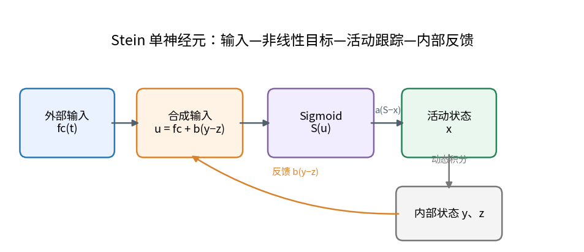
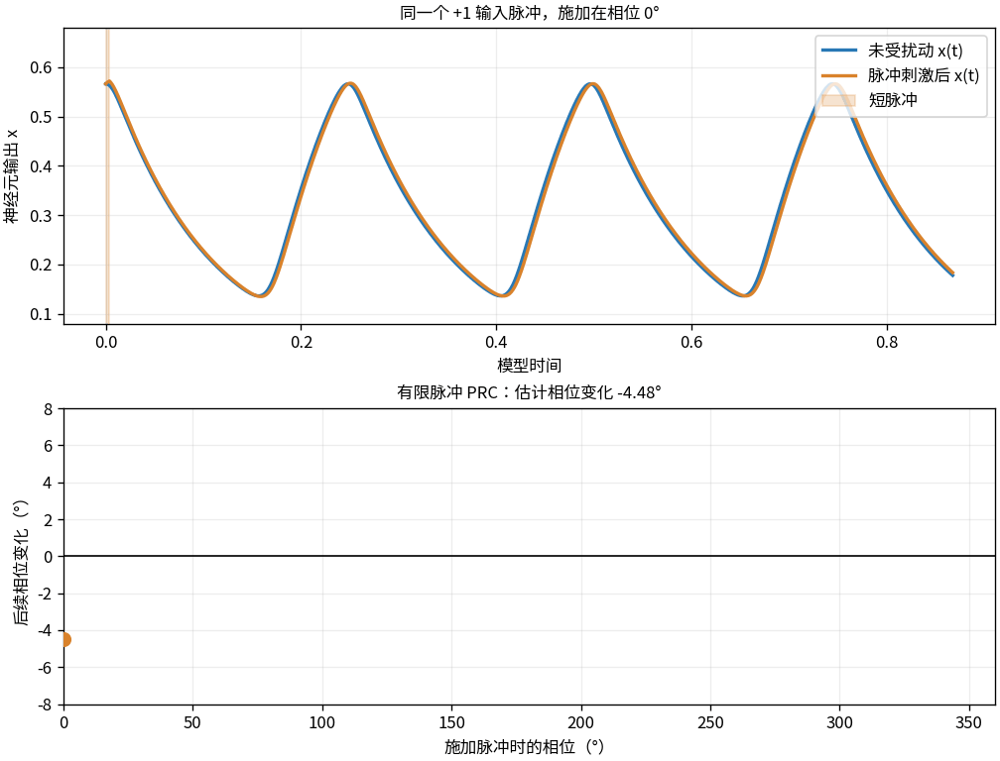
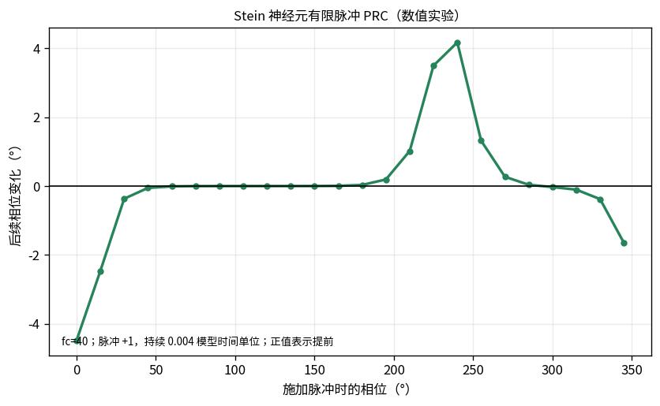
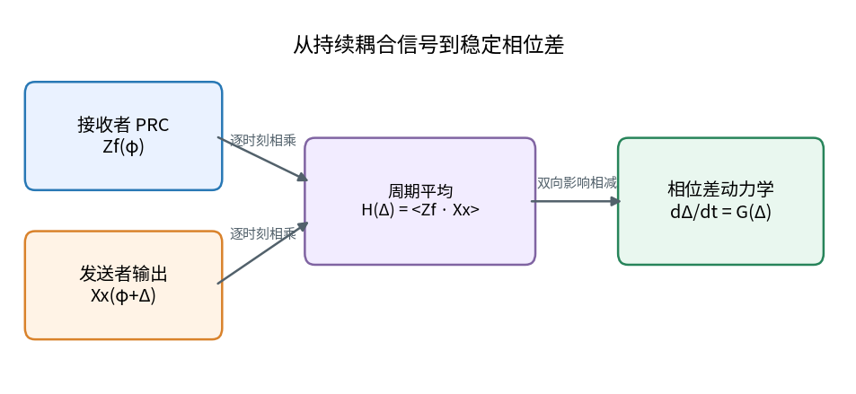
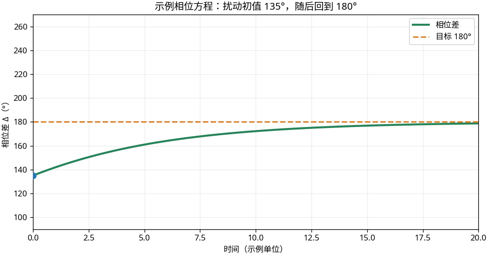
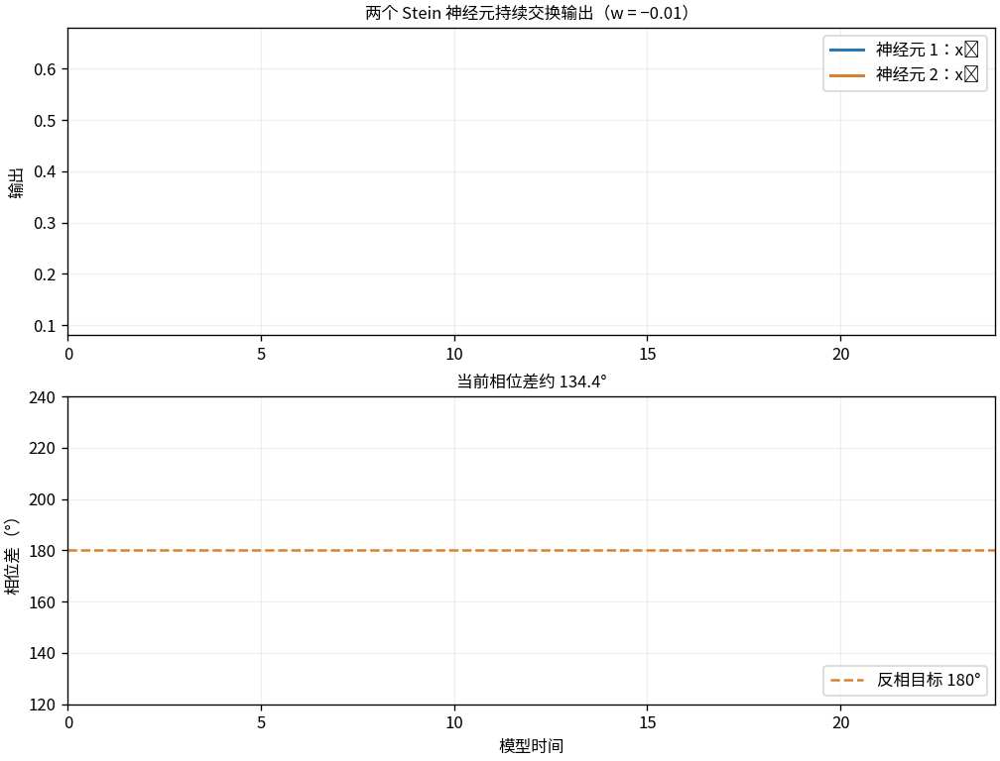

# Stein 神经元的 PRC、伴随方程与耦合函数

> **本篇学习范围**
>
> 本篇承接[《Stein 神经元模型》](/posts/stein-neural-oscillator/)笔记，整理从单个 Stein 神经元的相位响应曲线（PRC），到两个神经元持续耦合、耦合函数、相位差动力学与稳定相位锁定的学习内容。
>
> 本篇暂不展开四神经元 CPG，也不正式推导完整的相位约化理论。目标是先把 PRC、$J$、$B$、$Z$、$H$、$G$ 之间的关系理解清楚。

## 1. 先明确研究对象：Stein 神经元

采用前面学习的 Stein 神经元方程：

$$
\begin{aligned}
\dot{x} &= a[S(u)-x],\\
\dot{y} &= x-py,\\
\dot{z} &= x-qz,
\end{aligned}
\qquad
u=f_c+b(y-z)
$$

其中：

$$
S(u)=\frac{1}{1+e^{-u}}
$$

教学计算采用的参数为：

$$
a=10,\quad b=-2000,\quad p=10,\quad q=30,\quad f_c=40
$$

定义状态向量：

$$
X=\begin{bmatrix}x\\y\\z\end{bmatrix}
$$

则原始动力学可以写成：

$$
\dot X=F(X,f_c)
$$

其中：

$$
F(X,f_c)=
\begin{bmatrix}
a[S(f_c+b(y-z))-x]\\
x-py\\
x-qz
\end{bmatrix}
$$

### 1.1 输入、状态和输出

- $f_c$：神经元的外部驱动输入。在 CPG 网络中，它可以由高层驱动和其他神经元的连接输出共同构成。
- $x$：神经元活动输出。
- $y,z$：神经元内部的两个动态变量，分别以不同时间尺度跟踪 $x$，并通过差值 $y-z$ 反馈到 $x$ 的活动目标。

这里的 $f_c$ 是模型中的数值驱动，不是电机电流；$x$ 也不是直接的关节角度。

### 1.2 连续耦合与 PRC 测试脉冲不是一回事

真实双神经元耦合可以写成：

$$
f_{c1}(t)=f_0+c_{21}x_2(t),\qquad
f_{c2}(t)=f_0+c_{12}x_1(t)
$$

只要 $x_1(t),x_2(t)$ 连续变化，输入通常也连续变化。神经元状态由微分方程连续演化。

PRC 实验则是人为设计的测量方法：在某个选定相位施加一个短暂的小脉冲，再观察后续相位变化。它不是说真实耦合网络只在某些时刻才传递信号。

即使输入是阶跃，有限的输入变化也只会使状态导数发生变化；在普通微分方程模型中，状态 $x,y,z$ 本身仍然连续。



## 2. 什么是相位？

单个神经元进入稳定周期振荡后，状态沿着三维状态空间中的一条闭合轨迹运动：

$$
X_0(t)=
\begin{bmatrix}
x_0(t)\\y_0(t)\\z_0(t)
\end{bmatrix}
$$

设周期为 $T$，定义角相位：

$$
\theta(t)=\omega t+\theta_0,\qquad
\omega=\frac{2\pi}{T}
$$

相位表示振荡处于周期中的哪个位置。本文约定 $x$ 达到峰值的位置为 $0^\circ$。

相位不是额外的物理状态，而是对周期运动位置的描述。

### 2.1 渐近相位（Asymptotic Phase）

对稳定极限环附近的状态，可以定义渐近相位函数：

$$
\theta=\Theta(X)
$$

它不仅告诉我们状态点在周期轨迹附近的几何位置，还告诉我们：该状态在之后自由演化并趋近极限环时，会对应到周期轨迹上的哪个相位。

这解释了一个重要现象：

- 稳定极限环能够使状态偏离后重新靠近周期轨迹；
- 但状态可能回到周期轨迹上的另一个相位位置；
- 因此，单个自治振荡器的振幅扰动可以衰减，相位偏移却可以保留下来。

## 3. PRC：相位响应曲线是什么？

PRC（Phase Response Curve）描述振荡器在周期的不同位置受到刺激后，相位会提前还是延迟，以及变化多少。

### 3.1 有限脉冲 PRC 与无穷小 PRC

**有限脉冲 PRC**：在某个相位施加固定幅值、固定持续时间的脉冲，比较受扰与未受扰系统后续的峰值时间。

**无穷小 PRC（iPRC）**：把刺激幅值或总作用量取到足够小，描述相位对输入微小变化的一阶敏感性。

二者相关，但不是同一个数值对象。有限脉冲太强时，可能显著改变振幅和波形，不能直接当作 iPRC。

本文采用的符号约定：

- 正的相位变化：提前（advance）；
- 负的相位变化：延迟（delay）。

对于短而弱的输入脉冲：

$$
\delta\theta\approx Z_f(\theta_0)\int \delta f_c(t)\,dt
$$

如果脉冲足够短，可以近似为：

$$
\delta\theta\approx Z_f(\theta_0)\,\delta f_c\,\tau
$$

其中 $\tau$ 是脉冲持续时间。





> **如何读 PRC 图**
>
> 横轴是刺激发生时的相位，纵轴是刺激造成的相位变化。它不是神经元输出 $x$ 的幅值曲线。

## 4. $B(X)$：外部输入如何改变状态变化率？

将 Stein 方程写成：

$$
\dot X=F(X,f_c)
$$

外部输入 $f_c$ 只直接进入第一个方程，因此定义输入方向向量：

$$
B(X)=\frac{\partial F}{\partial f_c}
$$

令：

$$
u=f_c+b(y-z)
$$

Sigmoid 的导数为：

$$
S'(u)=\frac{dS}{du}=S(u)[1-S(u)]
$$

逐项对 $f_c$ 求偏导：

$$
\frac{\partial \dot x}{\partial f_c}=aS'(u),\quad
\frac{\partial \dot y}{\partial f_c}=0,\quad
\frac{\partial \dot z}{\partial f_c}=0
$$

所以：

$$
\boxed{
B(X)=
\begin{bmatrix}
aS'(u)\\0\\0
\end{bmatrix}
}
$$

物理意义：$B(X)$ 描述外部输入增加一点时，三个状态的变化率分别直接改变多少。

对于微小输入变化：

$$
\delta\dot X\approx B(X)\delta f_c
$$

注意，这里改变的是状态的**变化率**，不是状态 $X$ 瞬间跳变。

## 5. $J$：雅可比矩阵描述状态扰动如何演化

定义：

$$
J(X)=\frac{\partial F}{\partial X}
$$

它是对原始状态方程分别关于 $x,y,z$ 求偏导得到的矩阵。

对于 Stein 神经元：

$$
\boxed{
J=
\begin{bmatrix}
-a&abS'(u)&-abS'(u)\\
1&-p&0\\
1&0&-q
\end{bmatrix}
}
$$

其物理意义是：如果状态发生一个很小的偏离，原本的状态变化率会怎样改变。

对状态方程在某条参考轨迹附近线性化：

$$
F(X_0+\delta X)
\approx F(X_0)+J(X_0)\delta X
$$

因此扰动满足变分方程：

$$
\boxed{
\delta\dot X=J(X_0(t))\delta X
}
$$

$J$ 不是相位响应曲线，它描述的是状态扰动的局部演化。

## 6. $Z$：相位对状态的梯度

### 6.1 从状态到相位

由于相位是状态的函数：

$$
\theta=\Theta(X)
$$

当状态发生微小变化时，对多元函数作一阶泰勒展开：

$$
\delta\theta\approx
\frac{\partial\Theta}{\partial x}\delta x+
\frac{\partial\Theta}{\partial y}\delta y+
\frac{\partial\Theta}{\partial z}\delta z
$$

定义：

$$
\boxed{
Z(\theta)=\nabla\Theta(X_0(\theta))=
\begin{bmatrix}
Z_x\\Z_y\\Z_z
\end{bmatrix}
}
$$

于是：

$$
\boxed{
\delta\theta\approx Z^T\delta X
}
$$

$Z_x,Z_y,Z_z$ 分别表示状态沿 $x,y,z$ 方向微小变化时，对渐近相位的敏感程度。

### 6.2 一个二维圆周例子

若状态在圆上运动：

$$
X=\begin{bmatrix}x\\y\end{bmatrix},
\qquad
\theta=\operatorname{atan2}(y,x)
$$

则：

$$
Z=\nabla\Theta(X)=
\begin{bmatrix}
-\dfrac{y}{x^2+y^2}\\[4pt]
\dfrac{x}{x^2+y^2}
\end{bmatrix}
$$

在圆周右端 $X=[R,0]^T$：

$$
Z=\begin{bmatrix}0\\1/R\end{bmatrix}
$$

所以径向微小变化在一阶近似下不改变相位，而切向变化会改变相位。

Stein 的极限环是三维闭合曲线，通常无法像圆周那样直接写出简单的 $\operatorname{atan2}$ 相位函数。因此需要通过伴随方程数值计算 $Z$。

## 7. 为什么出现 $\frac{d}{dt}(\delta\theta)=0$？

这一步的前提是：**一次扰动已经结束，之后两个相近状态都按照同一个自治振荡器自由演化。**

假设一条轨迹没有受扰，另一条轨迹受到微小扰动。扰动后，两条轨迹的渐近相位分别为：

$$
\theta_1(t),\qquad\theta_2(t)
$$

对同一个自治振荡器，渐近相位均以自然角频率 $\omega$ 推进：

$$
\dot\theta_1=\omega,\qquad
\dot\theta_2=\omega
$$

定义二者相位偏差：

$$
\delta\theta=\theta_2-\theta_1
$$

则：

$$
\frac{d}{dt}(\delta\theta)
=\dot\theta_2-\dot\theta_1
=\omega-\omega=0
$$

所以：

$$
\boxed{
\frac{d}{dt}(\delta\theta)=0
}
$$

它表示扰动结束后，相位偏差保持不变；不表示神经元停止振荡，也不表示扰动前后的相位差相同。

例如，原相位为 $0^\circ$，扰动使另一条轨迹提前 $30^\circ$。之后两者都继续以相同频率运行，相位差就保持 $30^\circ$。

> **适用范围**
>
> 这个等式用于推导单个自治振荡器的 iPRC 伴随方程。对于两个持续耦合的振荡器，相位差一般会继续变化，不能直接令其导数为零。

## 8. 从 $J$ 和 $Z$ 推导伴随方程

已知：

$$
\delta\theta=Z^T\delta X
$$

以及状态扰动的变分方程：

$$
\delta\dot X=J\delta X
$$

扰动结束后，渐近相位偏差保持不变：

$$
\frac{d}{dt}(Z^T\delta X)=0
$$

使用乘积求导：

$$
\dot Z^T\delta X+Z^T\delta\dot X=0
$$

代入 $\delta\dot X=J\delta X$：

$$
\dot Z^T\delta X+Z^TJ\delta X=0
$$

整理：

$$
(\dot Z^T+Z^TJ)\delta X=0
$$

由于这个关系需要对任意足够小的状态扰动成立，因此：

$$
\dot Z^T+Z^TJ=0
$$

转置后得到：

$$
\boxed{
\dot Z=-J^TZ
}
$$

这就是伴随方程（Adjoint Equation）。

它不是新的神经元状态方程，而是用于计算相位梯度 $Z$ 沿着稳定周期轨迹如何变化。

## 9. 为什么有归一化条件 $Z^TF=\omega$？

由于：

$$
\theta=\Theta(X)
$$

对时间求导，使用多元函数链式法则：

$$
\dot\theta=
\frac{\partial\Theta}{\partial x}\dot x+
\frac{\partial\Theta}{\partial y}\dot y+
\frac{\partial\Theta}{\partial z}\dot z
$$

也就是：

$$
\dot\theta=Z^T\dot X=Z^TF(X)
$$

在稳定周期轨道上，相位从 $0$ 到 $2\pi$，每个周期用时 $T$，因此：

$$
\dot\theta=\omega=\frac{2\pi}{T}
$$

所以：

$$
\boxed{
Z^TF(X_0(t))=\omega
}
$$

这个条件还用于确定伴随向量 $Z$ 的正确尺度，即归一化。

## 10. 从 $Z$ 和 $B$ 得到输入 PRC

有外部输入时：

$$
\dot X=F(X,f_c)
$$

在基准输入附近增加微小输入变化 $\delta f_c$，一阶展开：

$$
\dot X\approx F(X)+B(X)\delta f_c
$$

利用相位链式法则：

$$
\dot\theta=Z^T\dot X
$$

代入：

$$
\dot\theta=Z^T[F(X)+B(X)\delta f_c]
$$

展开：

$$
\dot\theta=Z^TF(X)+Z^TB(X)\delta f_c
$$

在极限环上使用归一化条件：

$$
Z^TF(X_0)=\omega
$$

得到：

$$
\dot\theta=\omega+Z^TB(X_0)\delta f_c
$$

定义输入相位响应函数：

$$
\boxed{
Z_f(\theta)=Z(\theta)^TB(X_0(\theta))
}
$$

对 Stein 模型：

$$
Z=
\begin{bmatrix}Z_x\\Z_y\\Z_z\end{bmatrix},
\qquad
B=
\begin{bmatrix}aS'(u)\\0\\0\end{bmatrix}
$$

因此：

$$
\begin{aligned}
Z_f
&=
\begin{bmatrix}Z_x&Z_y&Z_z\end{bmatrix}
\begin{bmatrix}aS'(u)\\0\\0\end{bmatrix}\\
&=Z_xaS'(u)+Z_y\cdot0+Z_z\cdot0
\end{aligned}
$$

最终：

$$
\boxed{
Z_f(\theta)=aZ_x(\theta)S'(u(\theta))
}
$$

为什么只剩 $Z_x$？因为外部输入只直接进入 $x$ 方程。$y,z$ 的间接影响已经体现在相位梯度 $Z_x$ 的计算中。

## 11. 从 PRC 到耦合函数

现在考虑两个已经处于稳定周期轨道附近的 Stein 神经元。

采用加性耦合形式：

$$
f_{c1}=f_0+c_{21}x_2(t),\qquad
f_{c2}=f_0+c_{12}x_1(t)
$$

其中 $c_{21},c_{12}$ 是两个方向的有效耦合系数。

在弱耦合近似下：

$$
\dot\theta_1
=\omega_1+c_{21}Z_f(\theta_1)X_x(\theta_2)
$$

$$
\dot\theta_2
=\omega_2+c_{12}Z_f(\theta_2)X_x(\theta_1)
$$

定义相位差：

$$
\Delta=\theta_2-\theta_1
$$

在一个共同周期内，令 $\theta_1=\phi$，则 $\theta_2=\phi+\Delta$。对快速变化的共同相位进行平均，定义：

$$
\boxed{
H(\Delta)=
\frac{1}{2\pi}
\int_0^{2\pi}
Z_f(\phi)X_x(\phi+\Delta)\,d\phi
}
$$

这就是耦合函数。

它不是新增的控制模块，而是由接收神经元的 PRC 和发送神经元的周期输出共同计算得到的周期平均规律。

### 11.1 用离散采样理解积分

把一个周期分成 $N$ 个等间隔采样点：

$$
\phi_k=\frac{2\pi k}{N}
$$

则：

$$
H(\Delta)\approx
\frac{1}{N}
\sum_{k=0}^{N-1}
Z_f(\phi_k)X_x(\phi_k+\Delta)
$$

每个采样点都做三件事：

1. 查接收神经元在该相位的 $Z_f$；
2. 查发送神经元在偏移相位的 $X_x$；
3. 两者相乘，最后求平均。



### 11.2 连续耦合为什么可以用周期平均？

真实耦合输入持续存在：

$$
\delta f_{c1}(t)=c_{21}x_2(t)
$$

因此瞬时相位修正为：

$$
Z_f(\theta_1)c_{21}x_2(t)
$$

当相位差变化较慢时，一个周期内的平均影响可以近似由 $H(\Delta)$ 表示。

所以 PRC 的脉冲实验是测量方法；真实网络中并不需要人为控制刺激发生时刻。

## 12. 从耦合函数到相位差动力学

周期平均后：

$$
\dot\theta_1=\omega_1+c_{21}H(\Delta)
$$

$$
\dot\theta_2=\omega_2+c_{12}H(-\Delta)
$$

两式相减：

$$
\boxed{
\dot\Delta=
\Delta\omega+c_{12}H(-\Delta)-c_{21}H(\Delta)
}
$$

其中：

$$
\Delta\omega=\omega_2-\omega_1
$$

定义：

$$
\boxed{\dot\Delta=G(\Delta)}
$$

$G$ 描述当前相位差如何变化：

- $G(\Delta)>0$：相位差增大；
- $G(\Delta)<0$：相位差减小；
- $G(\Delta)=0$：相位差是平衡点。

如果两个振荡器相同且对称耦合，$c_{12}=c_{21}=c$，则：

$$
G(\Delta)=c[H(-\Delta)-H(\Delta)]
$$

## 13. 如何判断稳定相位差？

目标相位差 $\Delta^*$ 必须满足：

$$
G(\Delta^*)=0
$$

这只说明它是平衡点，还不代表稳定。

局部渐近稳定的条件是：

$$
\boxed{G'(\Delta^*)<0}
$$

直观解释：

- 相位差略小于目标值时，$G>0$，推动相位差增大；
- 相位差略大于目标值时，$G<0$，推动相位差减小。

于是受到小扰动后，相位差会回到目标值附近。

在目标附近令 $e=\Delta-\Delta^*$，有：

$$
\dot e\approx G'(\Delta^*)e
$$

因此：

$$
e(t)\approx e(0)e^{G'(\Delta^*)t}
$$

$G'(\Delta^*)$ 越负，局部相位误差收敛越快。



> **两种稳定性不要混淆**
>
> 单个神经元的极限环稳定性，描述振幅或状态偏离后能否回到周期轨道附近。
>
> 多个神经元的相位锁定稳定性，描述相位差偏离后能否恢复到原来的相位关系。
>
> 两者不是同一个问题。

## 14. 目标相位差设计的计算流程

如果希望两个神经元稳定保持某个目标相位差，例如 $180^\circ$，可以按以下流程进行：

1. 求单个 Stein 神经元的稳定周期轨道 $X_0(\theta)$；
2. 求解伴随方程，得到状态相位梯度 $Z(\theta)$；
3. 通过 $Z_f=Z^TB$ 得到输入 iPRC；
4. 将 $Z_f$ 与发送神经元周期输出进行周期平均，计算 $H(\Delta)$；
5. 根据实际连接权重建立 $G(\Delta)$；
6. 寻找 $G(\Delta^*)=0$ 且 $G'(\Delta^*)<0$ 的参数；
7. 回到完整 Stein 网络，改变初始相位并施加扰动，验证是否恢复。

这是一种弱耦合参数分析方法。对于较强耦合、振幅偏离明显或振荡被破坏的情况，必须以完整神经元网络仿真为准。



## 15. MATLAB：计算 Stein 神经元的周期轨道与输入 iPRC

下面的程序只负责单个 Stein 神经元的周期轨道和输入 iPRC，不计算两个神经元的耦合函数。

保存为 `stein_prc_demo.m`，使用 MATLAB R2016b 或更新版本运行。

```matlab
%% Stein neuron: limit cycle and input iPRC
clear; clc; close all;

par.a  = 10;
par.b  = -2000;
par.p  = 10;
par.q  = 30;
par.fc = 40;

Xinit = [0.2; 0; 0];

opts = odeset('RelTol',1e-9, ...
              'AbsTol',1e-11, ...
              'MaxStep',1e-3);

%% 1. Find the stable periodic orbit
optsEvent = odeset(opts, ...
    'Events',@(t,X) peakEvent(t,X,par));

sol = ode45(@(t,X) steinRHS(t,X,par), ...
            [0 100], Xinit, optsEvent);

peakTimes = sol.xe;

if numel(peakTimes) < 3
    error('Not enough peaks detected.');
end

t0 = peakTimes(end-1);
T  = peakTimes(end)-peakTimes(end-1);
omega = 2*pi/T;

fprintf('T = %.8f\n',T);
fprintf('omega = %.8f\n',omega);

%% 2. Sample one period
N = 2000;
tau = linspace(0,T,N+1);

Xorb = deval(sol,t0+tau);
Xorb(:,end) = Xorb(:,1);

%% 3. Calculate J and F along the orbit
Jorbit = zeros(3,3,N+1);
Forbit = zeros(3,N+1);

for k = 1:N+1
    X = Xorb(:,k);

    u = par.fc + par.b*(X(2)-X(3));
    S = 1/(1+exp(-u));
    Sp = S*(1-S);

    Jorbit(:,:,k) = [ ...
        -par.a, par.a*par.b*Sp, -par.a*par.b*Sp;
         1,     -par.p,          0;
         1,      0,             -par.q];

    Forbit(:,k) = steinRHS(0,X,par);
end

%% 4. Solve the adjoint equation backward
F0 = Forbit(:,1);
Zend = [1;0;0];

optsAdj = odeset('RelTol',1e-8, ...
                 'AbsTol',1e-10, ...
                 'MaxStep',T/300);

for k = 1:100
    [~,Zback] = ode45( ...
        @(t,Z) adjointRHS(t,Z,tau,Xorb,par), ...
        [T 0], Zend, optsAdj);

    Zstart = Zback(end,:)';

    % Normalize so Z' * F = omega
    Zstart = Zstart * (omega/(Zstart'*F0));

    Zend = Zstart;
end

%% 5. Recover Z over one period
[~,Zback] = ode45( ...
    @(t,Z) adjointRHS(t,Z,tau,Xorb,par), ...
    linspace(T,0,N+1), Zend, optsAdj);

Zorb = flipud(Zback)';

%% 6. Calculate B(X) and input PRC
uOrbit = par.fc + par.b*(Xorb(2,:)-Xorb(3,:));
SOrbit = 1./(1+exp(-uOrbit));
Sprime = SOrbit.*(1-SOrbit);

Binput = zeros(3,N+1);
Binput(1,:) = par.a*Sprime;

% Z_f = Z' * B
Zf = sum(Zorb.*Binput,1);

phaseDeg = tau/T*360;

%% 7. Check normalization
phaseSpeed = sum(Zorb.*Forbit,1);

fprintf('Mean Z''*F = %.8f\n',mean(phaseSpeed));
fprintf('Expected omega = %.8f\n',omega);

%% 8. Plot results
figure('Color','w');

subplot(3,1,1);
plot(phaseDeg,Xorb(1,:),'LineWidth',1.5);
ylabel('x'); grid on;
title('Stein limit cycle');

subplot(3,1,2);
plot(phaseDeg,Xorb(2,:),'LineWidth',1.5);
hold on;
plot(phaseDeg,Xorb(3,:),'LineWidth',1.5);
ylabel('y,z');
legend('y','z'); grid on;

subplot(3,1,3);
plot(phaseDeg,Zf,'LineWidth',1.5);
xlabel('Phase (degree)');
ylabel('Z_f');
title('Input iPRC'); grid on;

%% Local functions
function dX = steinRHS(~,X,par)
    x = X(1);
    y = X(2);
    z = X(3);

    u = par.fc + par.b*(y-z);
    S = 1/(1+exp(-u));

    dX = [par.a*(S-x);
          x-par.p*y;
          x-par.q*z];
end

function [value,isterminal,direction] = ...
    peakEvent(~,X,par)

    dX = steinRHS(0,X,par);

    value = dX(1);
    isterminal = 0;
    direction = -1;
end

function dZ = adjointRHS(t,Z,tau,Xorb,par)
    phaseTime = mod(t,tau(end));

    X = interp1(tau,Xorb',phaseTime,'pchip')';

    y = X(2);
    z = X(3);

    u = par.fc + par.b*(y-z);
    S = 1/(1+exp(-u));
    Sp = S*(1-S);

    J = [ ...
        -par.a, par.a*par.b*Sp, -par.a*par.b*Sp;
         1,     -par.p,          0;
         1,      0,             -par.q];

    dZ = -J'*Z;
end
```

> **数值实现检查**
>
> 运行后应检查 `Mean Z'*F` 是否接近 `omega`，并检查 $Z$ 在周期首尾是否连续。伴随方程的数值求解对周期轨道精度、时间步长和收敛情况敏感。正式研究中应增加网格加密、周期边界误差和 PRC 收敛性检查。

## 15.1 关于数值结果的使用边界

> **不把未经复核的中间数值当作科研结果**
>
> 之前的学习对话中曾出现若干具体的 $Z_f$、$H(\Delta)$ 和 $G(\Delta)$ 数值表或曲线。由于当时没有完整展示同一套周期轨道、伴随解、相位归一化、周期积分网格和收敛性检查，本篇不将那些数值作为可引用的正式计算结果。
>
> 本篇保留的是可复现的数学定义、推导关系、MATLAB 单神经元 iPRC 计算程序，以及明确标注参数和假设的教学仿真 GIF。后续真正计算 Stein 耦合函数时，应从同一套经过收敛性检查的周期轨道和伴随解出发，重新采样并计算 $H$、$G$，再与完整耦合 Stein 方程交叉验证。

## 16. 本篇最重要的概念对照

| 符号 | 定义 | 回答的问题 |
|---|---|---|
| $J$ | $\partial F/\partial X$ | 状态扰动怎样改变状态变化率？ |
| $B$ | $\partial F/\partial f_c$ | 输入变化怎样改变状态变化率？ |
| $Z$ | $\nabla\Theta(X)$ | 状态变化怎样改变相位？ |
| $Z_f$ | $Z^TB$ | 输入变化怎样改变相位？ |
| $H$ | PRC 与周期输出的周期平均 | 一个方向的持续耦合平均产生多大相位影响？ |
| $G$ | 两个方向的相位影响合成 | 相位差会增大还是减小？ |

## 17. 下一步学习：相位约化

下一课建议正式学习相位约化（Phase Reduction），重点解决：

1. 为什么稳定极限环附近的三维状态可以近似由一个相位变量描述？
2. 这种降阶近似保留了什么、忽略了什么？
3. 为什么弱耦合条件下，可以把两个神经元的完整状态方程转化为相位方程？
4. 什么时候相位约化会失效，必须回到完整 Stein 方程？

完成这一步后，再系统学习耦合函数和相位锁定的参数设计，就可以自然过渡到四神经元 CPG 网络。

---

## 本篇学习总结

本篇的核心逻辑是：

$$
\boxed{
\text{Stein 原始动力学}
\rightarrow
J,\ B
\rightarrow
Z
\rightarrow
Z_f
\rightarrow
H(\Delta)
\rightarrow
G(\Delta)
}
$$

- $J$ 描述状态扰动的局部演化。
- $B$ 描述外部输入对状态变化率的直接影响。
- $Z$ 描述状态对渐近相位的敏感性。
- $Z_f$ 描述输入对相位的敏感性。
- $H$ 将持续耦合在一个周期内的影响平均化。
- $G$ 描述两个神经元的相位差动力学。

掌握这条链条，才算真正从单个 Stein 神经元走向耦合振荡器理论。
